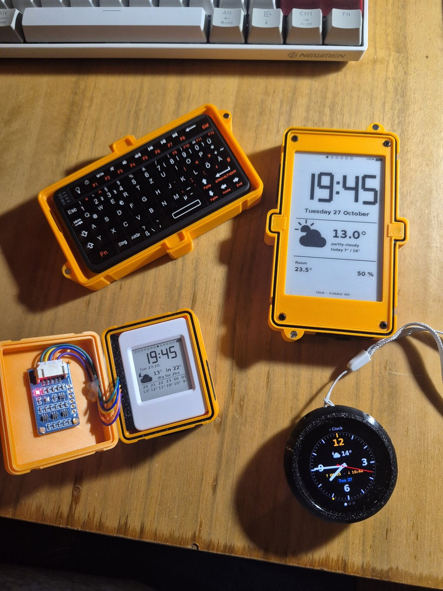

# E!nkster: open firmware for small e-paper boards

E!nkster turns small ESP32-S3 e-paper boards into calm pocket devices: a clock that ticks on paper, the weather, offline card packs, a radio, a typewriter, a shelf of offline archives. They sleep most of the time, so they run for days on battery.

This repository holds the firmware for two Waveshare boards:
- **E!nkster 154**: Waveshare **ESP32-S3-Touch-ePaper-1.54 (V2)**, 200 × 200, touch. Version **v0.26.2**.
- **E!nkster 397**: Waveshare **ESP32-S3-ePaper-3.97**, 800 × 480, a dial and a Bluetooth keyboard. Version **v0.4.0**.

It also holds the files both boards share and **the shelf converter**, which turns Kiwix archives into text the 397 reads from its microSD card.

Built with AI assistance (Claude), and signed "Written by Julien and Claude the AI". Every file is reviewed, credited and maintained by a person, and this repository is the maintained home, not a dump.



## The family
| Board | Where it lives |
|---|---|
| **1.54″**, the E!nkster 154 | here: `einkster154.ino` |
| **3.97″**, the E!nkster 397 | here: `397/` |
| **1.75″ round AMOLED**, the 175 | its own firmware, developed separately; it takes copies of `ek_shared.h` and `fonts.h` from here |
| **Xteink X4**, dual boot | its own firmware, developed separately |
| **Colour photo frames** | their own firmware, developed separately; they share the tile names, journal line and settings names of `ek_shared.h` |

## What the boards do
**E!nkster 154**
- **Tiles**, swiped on the touch screen: Clock (with alarm and timer, ringing from sleep), Weather, Climate (a 7-day room graph), Editions (offline card packs), Catalog (links as big QR codes), Radio (FIP live), Kaffeesatz (a daily edito, with your channel code), Battery (on builds with your keys), Cl!cker (the board as a Bluetooth keyboard), Device. With your own relay, it also has Ask (hold, speak, read the answer on paper), Der Die Das, Oracle and Jar.
- **Sensors:** room temperature and humidity on the board, and an optional pressure sensor whose power the firmware switches on only to read.
- **Battery:** a sample every 30 minutes, a reserve mode below 3.55 V, and a clean switch-off at 3.51 V.

**E!nkster 397**
- The same Clock, Climate, Editions and Catalog, on a large page, driven by the dial or a paired Bluetooth keyboard on every screen.
- A **typewriter** that writes to the microSD card.
- **The shelf:** offline archives (a Wikipedia, for instance), searched by title from the keyboard, with no database.
- A 7-day **battery log** with the drain per day and the time left.

Both boards are set up from a phone: the board opens its own hotspot, with a QR code to join it. On that page you add Wi-Fi networks, set the clock and the language (English or French), and, on builds with your keys, read or download the field log. The field log never holds a network name, a password or a key.

## The files
| File | What it is |
|---|---|
| `einkster154.ino`, `audio.c`, `audio.h`, `ek_hid.h` | the 154's firmware, its audio and its Bluetooth keyboard |
| `397/einkster397.ino`, `397/partitions.csv` | the 397's firmware and its 16 MB layout |
| `ek_shared.h` | what every E!nkster board shares: tile ids, settings names, the field log line |
| `fonts.h` | the bitmap typeface (DejaVu Sans Bold) |
| `ek_link.h`, `link/` | the radio link (ESP-NOW) between the 154 and the peek-a-boo cat toy, with its notes and bench; the 154's cat toy mode that uses it is still to come |
| `397/shelf/` | the shelf converter and its format: see `397/shelf/README.md` |
| `prepare.py`, `397/prepare397.py` | assemble each sketch before compiling |
| `397/tests/` | the 397's bench: the firmware run on a computer, with test archives |
| `TEST-*.md`, `397/TEST-*.md` | the notes that shipped with each version |

## Your keys
The boards hold no key from this repository. Your board brings its own:
1. Copy `config.example.h` to `config.h` and fill it in. `config.h` is listed in `.gitignore` and never goes into git.
2. The tiles that talk (Ask, Der Die Das, Oracle, Jar) need **your own relay**: a small server that holds your AI key and answers the board. The InvisibleChaos relay is private and not part of this repository.
3. Or build with **no keys at all**, and set up Wi-Fi on the device: `EK_EDITION=invisibleocean` for the 154, `EK_NO_SECRETS=1` for the 397.

## Build
You need Python 3, git, [arduino-cli](https://arduino.github.io/arduino-cli/) and the ESP32 core **3.2.0**:
```
arduino-cli config init
arduino-cli config add board_manager.additional_urls https://espressif.github.io/arduino-esp32/package_esp32_index.json
arduino-cli core update-index
arduino-cli core install esp32:esp32@3.2.0
```
**E!nkster 154.** `prepare.py` fetches Waveshare's drivers and the Helix AAC decoder, and never changes them:
```
git clone --depth 1 https://github.com/waveshareteam/ESP32-S3-ePaper-1.54.git ws
python3 prepare.py ws sketch/einkster154                      # with your config.h
EK_EDITION=invisibleocean python3 prepare.py ws sketch/einkster154 # or with no keys
arduino-cli compile --export-binaries \
  --fqbn esp32:esp32:esp32s3:CDCOnBoot=cdc,FlashMode=qio,FlashSize=8M,PartitionScheme=default_8MB,PSRAM=opi \
  sketch/einkster154
```
**E!nkster 397.** It takes the power chip library from Waveshare's 3.97 demo:
```
git clone --depth 1 --filter=blob:none --sparse https://github.com/waveshareteam/ESP32-S3-ePaper-3.97.git ws397
git -C ws397 sparse-checkout set ESP-IDF/08_ESP32-S3_e-Paper-3.97/components/axpPower
python3 397/prepare397.py ws397 sketch397/einkster397                  # with your config.h
EK_NO_SECRETS=1 python3 397/prepare397.py ws397 sketch397/einkster397  # or with no keys
arduino-cli compile --export-binaries \
  --fqbn esp32:esp32:esp32s3:CDCOnBoot=cdc,FlashMode=qio,FlashSize=16M,PartitionScheme=default_8MB,PSRAM=opi \
  sketch397/einkster397
```

## Flash
The build leaves two files in the sketch's `build/` folder:
- `*.ino.merged.bin`, the **full** image: flash it at **0x0** the first time. It erases everything on the board.
- `*.ino.bin`, the **update**: flash it at **0x10000**. Settings, networks and logs stay.

Any ESP32 flasher works, for example `esptool.py` or a web flasher in Chrome or Edge.

## Tests
- The 397's bench: `397/tests/host/build.sh` runs the firmware on a computer, scene by scene.
- The link: `link/tests/run.sh`.

## Licence and credits
- **MIT**, see `LICENSE`. Third-party files keep their own licence and header.
- Every library, service, dataset and typeface is named in **`CREDITS.md`**.
- InvisibleChaos: [invisiblechaos.netlify.app](https://invisiblechaos.netlify.app/) · [Ethos](https://invisiblechaos.netlify.app/ethos.html) · [Impressum](https://invisiblechaos.netlify.app/impressum.html) · [Datenschutz](https://invisiblechaos.netlify.app/datenschutz.html)

Written by Julien and Claude the AI
